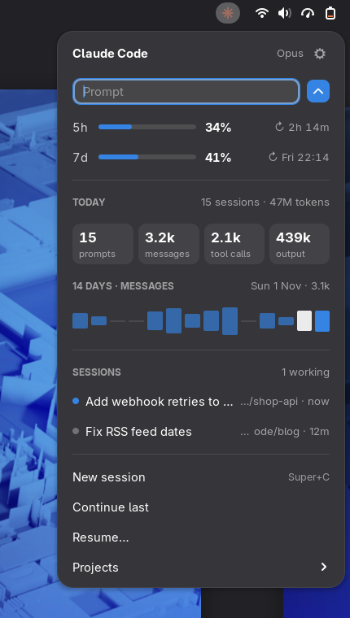
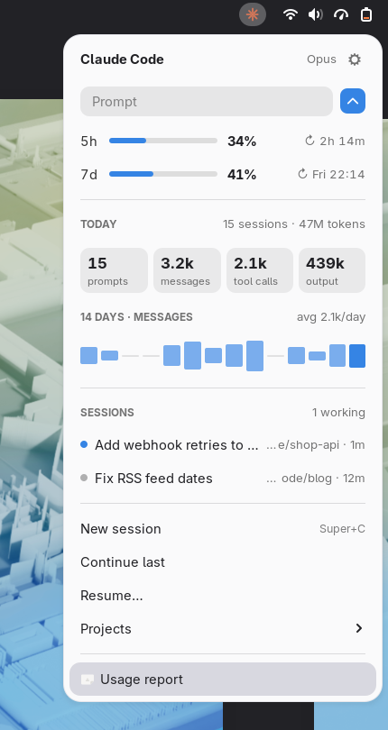
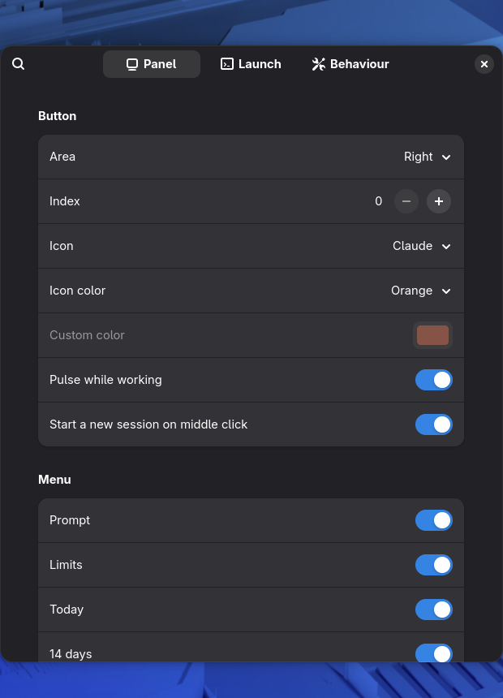

# Deck for Claude Code

A GNOME Shell extension that puts [Claude Code](https://docs.claude.com/en/docs/claude-code) in the top bar: start sessions with a prompt, jump to the terminal of a running session, get notified when a session finishes, reopen recent projects, and keep an eye on your usage limits.

Unofficial, not affiliated with Anthropic.

<p>
  
  
</p>

## Features

- **Prompt field.** Open the menu (<kbd>Super</kbd>+<kbd>Alt</kbd>+<kbd>C</kbd>), type, press <kbd>Enter</kbd>: a terminal opens with `claude "your prompt"`. Type a prompt and click a project to start it there instead.
- **Live sessions.** Every running Claude Code session with its title, folder and status. Click one to focus its terminal window.
- **Notifications** when a session finishes or needs input while you are in another window. Clicking the notification takes you to the terminal.
- **Recent projects** from your Claude Code history. Click to start a new session there, or the clock button to continue the last one (`claude --continue`).
- **New session** (<kbd>Super</kbd>+<kbd>C</kbd> or middle click on the icon), **Continue last**, **Resume…**
- **Usage limits**: 5-hour and weekly usage with reset times. See [Limits](#limits).
- **Stats**: prompts, messages, tool calls and output tokens for today, and a 14-day chart (hover a bar for that day, click the title to switch the metric).
- **Custom actions** and **custom CSS** that apply instantly, see [Customizing](#customizing).
- Follows the shell theme, light and dark, and its accent color.

Everything is read locally from `~/.claude`. The extension never reads your credentials and makes no network requests.

## Install

From source:

```sh
git clone https://github.com/artyomPlokhikh/claude-deck.git
cd claude-deck
make install
```

Log out and back in (GNOME Shell on Wayland loads new extensions only at login), then:

```sh
gnome-extensions enable claude-deck@artyomplokhikh.github.io
```

Requirements: GNOME Shell 50, Claude Code. `make install` symlinks the `extension` folder into `~/.local/share/gnome-shell/extensions/`, so `git pull` plus a re-login updates it.

## Limits

Claude Code sends your rate limits to its [status line](https://docs.claude.com/en/docs/claude-code/statusline) command. The extension ships a small wrapper that saves them and passes everything through to your own status line.

In `~/.claude/settings.json`:

```json
{
  "statusLine": {
    "type": "command",
    "command": "sh ~/.local/share/gnome-shell/extensions/claude-deck@artyomplokhikh.github.io/tools/statusline-tee.sh"
  }
}
```

If you already have a status line, put its command after the wrapper:

```json
"command": "sh ~/.local/share/gnome-shell/extensions/claude-deck@artyomplokhikh.github.io/tools/statusline-tee.sh bash ~/.claude/statusline-command.sh"
```

A command with pipes goes in as one quoted argument: `.../statusline-tee.sh 'my-cmd | other-cmd'`.

Limits update whenever a Claude Code session is running. The command is also in the preferences, under Behaviour → Limits, with a copy button.

## Customizing

Preferences cover position, icon and color, menu sections, terminal, shell, default folder, extra `claude` arguments, shortcuts and notifications.

Two files in `~/.config/claude-deck/` go further and apply as soon as you save them:

- `style.css`: any CSS on top of the built-in style.
- `actions.json`: your own menu items, for example "review this branch" or "ask in the background and copy the answer".

[CUSTOMIZING.md](CUSTOMIZING.md) documents every setting, CSS class and action option. It is written so Claude Code can use it too, so you can just ask:

> Read ~/.local/share/gnome-shell/extensions/claude-deck@artyomplokhikh.github.io/CUSTOMIZING.md and make the deck use my terminal colors, hide the chart and add an action that runs /review in ~/code/shop.



## Development

```sh
make            # build stylesheets and schemas
make lint       # eslint
make test       # headless GNOME Shell with fake Claude Code data, 23 checks
make screenshots
make pack       # zip for extensions.gnome.org in dist/
```

`make test` needs `mutter-devkit` (Fedora) for `gnome-shell --headless`. It runs with a temporary `HOME`, XDG folders and D-Bus session, so your session, settings and `~/.claude` are not touched.

Layout:

- `extension/extension.js`: lifecycle, refresh, notifications, launching
- `extension/lib/menu.js`: the panel button and menu
- `extension/worker/stats-worker.js`: reads `~/.claude` in a separate `gjs` process so the shell never blocks on large transcripts
- `extension/tools/statusline-tee.sh`: status line wrapper
- `src/stylesheet.css.in`: template for `stylesheet-dark.css` and `stylesheet-light.css`

## License

GPL-2.0-or-later
